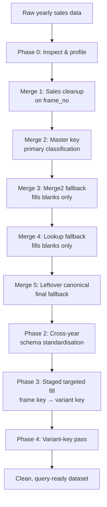

# Sales Data Canonical Classification Pipeline

A Python ETL pipeline that takes five fiscal years of messy vehicle sales records (3.5M+ rows) and resolves every record to one clean, standard vehicle classification, ready for BI reporting.

```
maker | model_ | grade_trim | engine | transmission | canonical_variant
```

Built with **Python and Pandas** for a real reporting workload. The data itself is confidential and is not in this repo. File names, sheet names and identifiers have been anonymised.

---

## The problem

The source data had no reliable vehicle classification:

- The same vehicle variant was written dozens of ways (`1.5 XL A/T`, `1.5XL AT `, `1.5 xl a/t`)
- Join keys didn't line up between files: trailing spaces, mixed types, `"nan"` stored as text, zeros used as blanks
- Lookup sheets had duplicate keys, which **multiply rows** in a normal left merge
- Each fiscal year had a slightly different schema: renamed columns, helper columns left behind, duplicated headers
- No single mapping source covered every record

Without a canonical classification, sales can't be reliably aggregated by model, trim or variant, so every downstream report inherits the mess.

---

## How it works

The pipeline runs in five phases, in the order the problem was actually solved.



### Phase 0: Inspect and profile
Lists every sheet's shape and columns, profiles lookup tables (nulls, heads, column meanings), and checks lookup keys for duplicates *before* any merge runs.

### Phase 1: Per-year enrichment (a five-stage merge chain)
Each stage only fills what earlier stages left blank:

| Stage | Source | Join key | Purpose |
|---|---|---|---|
| 1 | Sales cleanup | `frame_no` (or row-aligned copy) | Adds material, description, model |
| 2 | Master key | `vehicle_variant` / `repair_order_number` | Primary canonical classification |
| 3 | Merge2 sheet | `vehicle_variant` | Fallback for unmatched variants |
| 4 | Lookup sheet | `vehicle_variant` | Second fallback |
| 5 | Leftover canonical workbook | `frame_no` / `raw_variant` | Final fallback for the remainder |

The join key differs by year because the source sheets differ, so each year is a config entry rather than a separate script.

### Phase 2: Cross-year standardisation
Brings all five years onto one fixed 44-column schema. It handles year-specific renames and drops known helper columns, then applies a leftover fill using **normalised** frame numbers (`' abc-123 '` → `ABC123`).

### Phase 3: Staged targeted fill
For the newest year, this runs a sequence of keyed stages: frame number first, then normalised vehicle variant against an older year's lookup. Each stage writes its own output and is verified independently.

### Phase 4: Variant-key pass
A final pass on an already-cleaned year that fills the remaining fully blank rows by normalised variant match.

---

## Data integrity guarantees

Every stage is checked as it runs. Wrong data fails loudly instead of slipping through:

- **No row explosion.** The row count is checked after every merge, merges use `validate="many_to_one"`, and the later phases fill through `Series.map`, which cannot multiply rows.
- **Populated values are never overwritten.** Fallbacks only fill blanks. Rows that held any canonical value before a stage are snapshotted and compared afterwards, and the pipeline stops if a single protected cell changed.
- **Schema is enforced.** Exact final column count and order, no duplicate or leftover temporary columns.
- **Outputs are verified.** Every written workbook is reopened and its rows, columns, headers and sample rows are checked against the in-memory frame.
- **Blanks are handled consistently.** `NaN`, `""`, `0`, `"0.0"`, `"nan"`, `"null"`, `"n/a"` and similar values are all treated as blank, so a zero is never written into a classification field.

---

## Design decisions

**Completeness-ranked deduplication.** When a lookup has duplicate keys, the pipeline keeps the row with the most populated classification fields rather than just the first one. A stable sort means ties keep their original source order.

**The all-six-blank eligibility rule.** In the staged phases, a row can be filled only if *all six* classification fields are blank. That way a partially classified row is never mixed with values from a different source.

**Normalised exact matching, not fuzzy matching.** Keys are uppercased and stripped of non-alphanumeric characters (`1.5 XL A/T` → `15XLAT`). This catches formatting noise without the false positives fuzzy matching brings to vehicle trims that differ by one character.

**Header standardisation with collision detection.** All headers are snake_cased on load. One year contained both `Model` and `Model ` (trailing space) as genuinely separate fields, so per-year overrides run first, and the pipeline stops if two columns would ever collapse into one name.

**Write-only Excel export.** Large frames are written row by row in openpyxl write-only mode, which keeps memory flat on 700K+ row sheets.

---

## Project structure

```
sales_etl_pipeline.py
├── Configuration              canonical schema, per-year configs, stage configs
├── 1. Header standardisation  snake_case + collision checks
├── 2. Phase 0                 inspection, profiling, key diagnostics
├── 3. Key cleaning            clean_key, normalisers, blank_or_zero, masks
├── 4. Validation              row/schema/protected-row checks
├── 5. Excel output            write_large_excel, verify_written_workbook
├── 6. Phase 1                 five-stage merge chain + runner
├── 7. Shared lookup logic     prepare_lookup, apply_lookup
├── 8. Phase 2                 cross-year standardisation runner
├── 9. Phase 3                 staged targeted fill runner
└── 10. Phase 4                variant-key pass
```

---

## Usage

```bash
pip install -r requirements.txt
```

Edit the configuration block at the top of `sales_etl_pipeline.py` with your file names, sheet names and join keys, then run everything:

```bash
python sales_etl_pipeline.py
```

or call individual phases:

```python
import sales_etl_pipeline as etl

etl.inspect_workbook("source_data_FY24-25.xlsx")
etl.run_base_enrichment(etl.PHASE1_CONFIGS["24-25"])
etl.run_cross_year_standardization()
etl.run_staged_fill()
etl.run_variant_pass()
```

### Adding a new year
Add an entry to `PHASE1_CONFIGS`:

```python
"26-27": {
    "source_file": "source_data_FY26-27.xlsx",
    "raw_sheet": "Raw Data",
    "sales_join": "frame_no",
    "master_key_join": "vehicle_variant",
    "master_key_columns": MASTER_KEY_COLUMNS,
    "use_merge2": True,
    "use_lookup": True,
    "leftover_join": "frame_no",
    "strict": True,
    "enforce_final_schema": True,
    "intermediate_output": None,
    "output_file": "enriched_FY26-27.xlsx",
},
```

---

## Tech stack

Python · Pandas · NumPy · openpyxl · python-calamine (fast Excel reads)

---

## What this fed into

The cleaned output became the fact table of a star-schema model, with KPI measures for sales and service performance. That model powered recurring Power BI reports, including a weekly performance tracker presented to senior management.
